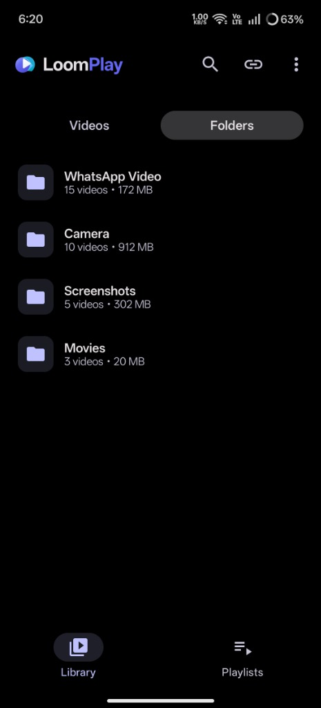
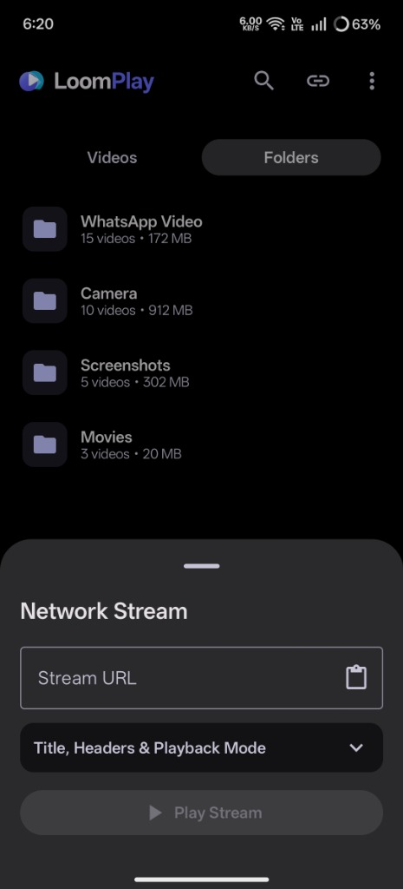
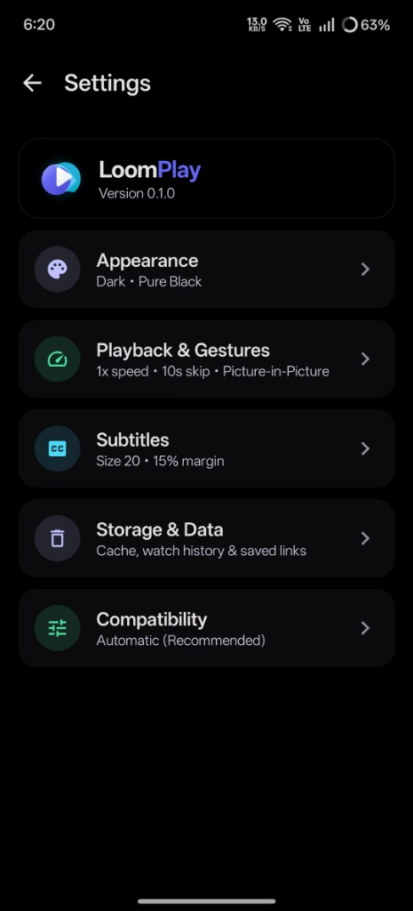
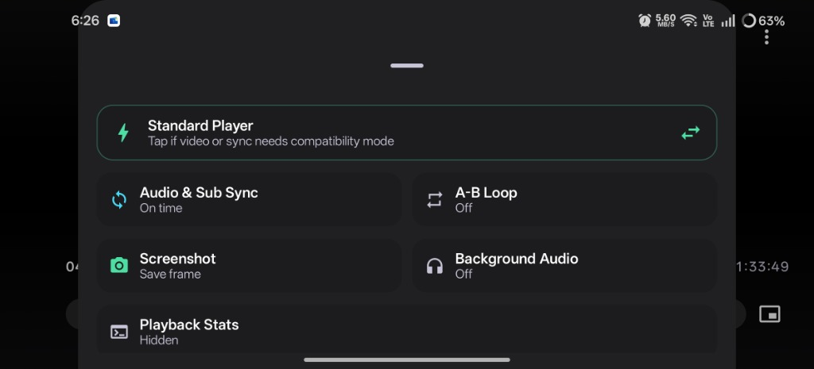
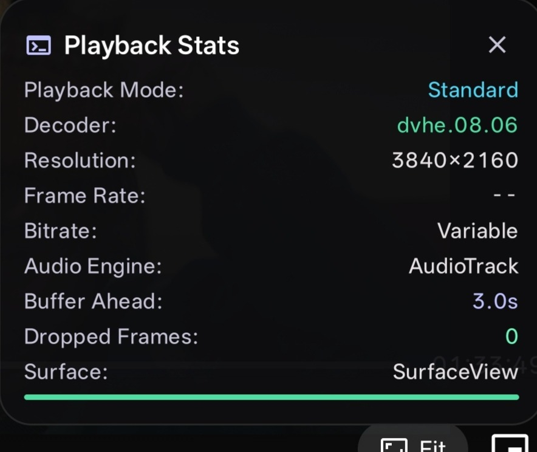

# LoomPlay

A clean, fast, and ad-free video player for Android, built for both your local video library and online network streams.

---

## Screenshots

<table>
  <tr>
    <td align="center" width="33%">
      <br />
      <sub><b>Library and Folders</b><br />Browse folders, sizes, and video counts cleanly</sub>
    </td>
    <td align="center" width="33%">
      <br />
      <sub><b>Network Streams</b><br />Paste links, add titles or headers, and play</sub>
    </td>
    <td align="center" width="33%">
      <br />
      <sub><b>Simple Settings</b><br />Customize theme, gestures, and subtitles</sub>
    </td>
  </tr>
</table>

<table>
  <tr>
    <td align="center" valign="bottom" width="55%">
      <br />
      <sub><b>Quick Player Tools</b><br />Switch playback mode, adjust sync, loop sections, capture frames, or listen in the background</sub>
    </td>
    <td align="center" valign="bottom" width="45%">
      <br />
      <sub><b>Playback Stats</b><br />Optional live view for resolution, decoder, bitrate, buffer, and dropped frames</sub>
    </td>
  </tr>
</table>

---

## Features

### Your Video Library, Organized
- **Videos & Folders View:** Switch between a full video list or folder view.
- **Continue Watching:** Pick up right where you left off from the top of your library.
- **Quick Search & Sorting:** Search videos or folders by name, and sort by **Date Added**, **Name**, **Duration**, or **Size**.
- **Open Any File:** Pick any video via **Open File** or choose LoomPlay directly from your phone's **"Open with"** menu.

### Custom Playlists
- Create, rename, and delete playlists right inside the **Playlists** tab.
- Reorder videos in any playlist and tap **Play All** for continuous playback with **Next / Previous** controls and an **Auto-Play Next** countdown.

### Watch Online Links & Streams
- Tap the link icon at the top of the library to play web videos and streams (`http`, `https`, `.m3u8`, `.mpd`, `rtsp`, `rtmp`).
- One-tap **clipboard paste**, optional custom title, and expandable support for custom headers (**User-Agent**, **Referer**, **Cookie**, and custom key/value pairs).
- Automatically saves **Recent** stream links so you can replay or edit them later.

### Built for Smooth Playback
- Plays standard phone videos cleanly and automatically switches to high-compatibility playback when needed for larger or less common video formats, with zero manual setup required.
- Supports hardware acceleration for smooth playback and lower battery drain.

### Easy Touch Gestures & Player Tools
- **Double-tap** the left or right side to skip back or forward (`5s`, `10s`, `15s`, or `30s`).
- **Swipe vertically** on the left side for screen brightness and on the right side for volume.
- **Swipe horizontally** across the video to jump forward or backward.
- **Hold down** on the screen to temporarily boost playback speed (`1.5x` to `3x`).
- **Pinch with two fingers** to zoom in and pan around the video.
- **Controls Lock** to prevent accidental taps while watching.
- **Extra Tools:** Switch **Playback Speed** (`0.25x` to `3x`), jump between **Chapters**, set an **A-B Loop** to repeat a section, change **Aspect Ratio** (`Fit`, `Fill`, `Stretch`, `16:9`, `4:3`), save **Screenshots** straight to your Pictures folder, or view optional live **Playback Stats** (resolution, bitrate, buffer, and dropped frames).

### Subtitles & Audio Controls
- Switch between multiple **Audio** and **Subtitle** tracks during playback.
- Automatically detects matching subtitle files in the same folder, or lets you pick a subtitle file manually.
- Customize subtitle **Text Size**, **Background Opacity**, **Bottom Margin**, and **Text Outline & Shadow**.
- Fix out-of-sync **Audio** or **Subtitles** in real time (`±50 ms` / `±250 ms`) right inside the player.

### Multitasking
- **Picture-in-Picture (PiP):** Keep watching in a floating mini-window when you leave the app.
- **Background Audio:** Keep listening to the audio when you minimize the app, complete with notification and lock-screen media controls.

### Appearance & Privacy
- Choose **System**, **Light**, or **Dark** theme, plus **Pure Black Dark Mode** for OLED displays and Android 12+ **Wallpaper Colors**.
- Enable **Clean Interface** to hide extra on-screen tags and details.
- Clear your **Thumbnail Cache**, **Watch History**, and **Saved Stream Links** anytime in **Settings -> Storage & Data**.

---

## How to Download & Install

LoomPlay supports **Android 8.0 and newer**.

1. Open the [**Releases**](https://github.com/thanveeralisayed/LoomPlay/releases) page.
2. Under the latest release's **Assets**, download:
   - **`LoomPlay-*-arm64-v8a.apk`**: Best choice for most modern Android phones (smallest download).
   - **`LoomPlay-*-universal.apk`**: Works on any Android phone or tablet if you aren't sure which version your device uses.
3. Open the downloaded `.apk` file on your device and allow installation from your browser or file manager if Android asks.

---

## Developer

Built by **Thanveer Ali** ([https://thanveer.vercel.app/](https://thanveer.vercel.app/))

---

<details>
<summary>For Developers: Build & Automated Releases</summary>

- **Build locally (Windows):**
  ```powershell
  .\gradlew.bat testDebugUnitTest :app:assembleRelease
  ```
- **Build locally (macOS / Linux):**
  ```bash
  ./gradlew testDebugUnitTest :app:assembleRelease
  ```
- **Automated GitHub Releases:** Pushing a version tag (e.g. `git tag v0.1.0 && git push origin v0.1.0`) or manually running the **Release APK** workflow from the **Actions** tab automatically runs tests, builds release APKs, and creates a GitHub Release with attached APKs and `SHA256SUMS.txt`.
- **Release Signing Secrets (optional):** Add `KEYSTORE_BASE64`, `KEYSTORE_PASSWORD`, `KEY_ALIAS`, and `KEY_PASSWORD` in **Settings -> Secrets and variables -> Actions** to sign CI releases with your permanent release keystore.

</details>
