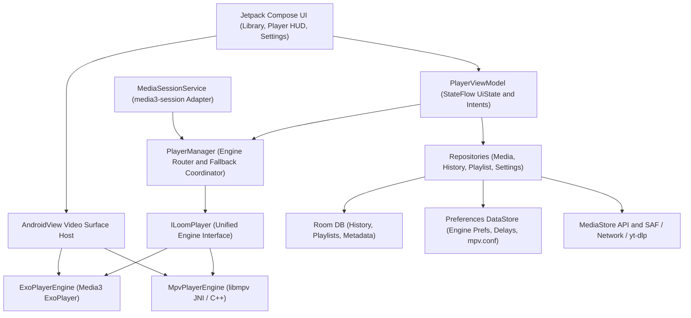
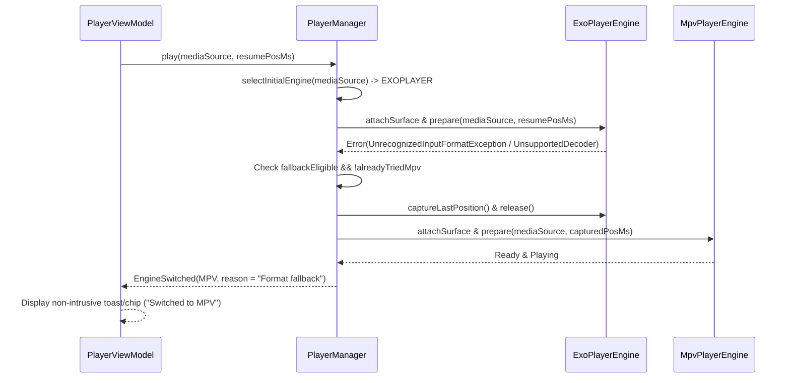
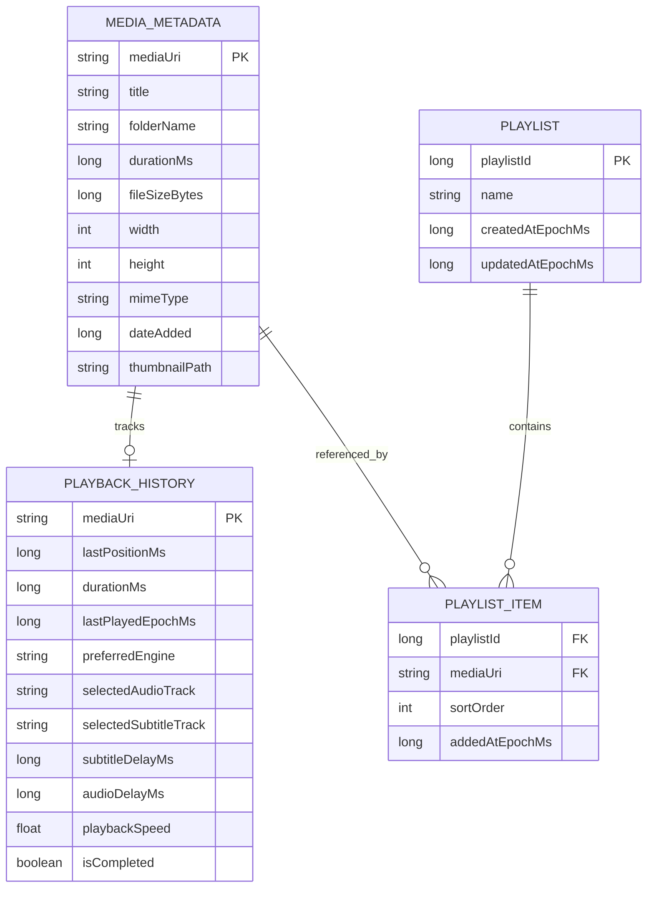

# Product Requirements Document (PRD): LoomPlay

**Version:** 1.0  
**Status:** Draft  
**Last Updated:** 2026-11-10  
**Platform:** Android (Native Kotlin)  
**Target Architecture:** Dual-Engine Playback (Media3 ExoPlayer + libmpv)  

---

## 1. Executive Summary & Vision

**LoomPlay** is a modern, native Android video player built from the ground up in **100% Kotlin** and **Jetpack Compose (Material Design 3)**. Its defining capability is a **Dual-Engine Playback Architecture** that intelligently switches between:

1. **Primary Engine — Media3 ExoPlayer (`androidx.media3:media3-exoplayer`):** Optimized for standard containers/codecs, hardware efficiency, DRM-protected playback (Widevine/ClearKey), adaptive streaming (HLS/DASH), and native OS integration.
2. **Secondary / Power Engine — MPV (`mpv-android` / `libmpv`):** Optimized for exotic formats and codecs, high-bitrate 4K/8K hardware and hybrid decoding (`mediacodec` / `HW+`), desktop-grade video scaling/debanding, advanced styled subtitle rendering (ASS/SSA/SRT), and deep customization via `mpv.conf`.

By unifying both engines behind a single abstraction (`ILoomPlayer`) orchestrated by a smart `PlayerManager`, LoomPlay delivers effortless reliability for everyday streaming while seamlessly falling back to MPV whenever ExoPlayer encounters unsupported formats or when power-user rendering is required.

---

## 2. Goals & Non-Goals

### 2.1 Primary Goals
- **Zero-Friction Format Compatibility:** Play virtually any local or network video format without forcing the user to manually pick decoders or switch apps.
- **Seamless Engine Fallback:** Automatically detect unsupported input formats or decoder failures in ExoPlayer and hand playback off to MPV at the exact timestamp with minimal interruption.
- **Modern Native Android Experience:** Pure Jetpack Compose UI with Material Design 3, dynamic theming, true AMOLED dark mode, fluid 60/120fps gesture overlays, Picture-in-Picture (PiP), and Android `MediaSession` integration.
- **Enthusiast-Grade Subtitle & Playback Precision:** Pixel-accurate ASS/SSA typesetting via `libmpv`, real-time audio/subtitle sync adjustment, multi-track switching, and `mpv.conf` configurability.
- **Clean, Maintainable Architecture:** Strict MVVM/MVI separation, Hilt dependency injection, Room persistence, DataStore preferences, and modular Gradle Kotlin DSL structure.

### 2.2 Non-Goals (Out of Scope for Initial Releases)
- Video editing, trimming, transcoding, or exporting features.
- Built-in media server hosting or cloud media storage synchronization.
- Legacy XML View hierarchies or Java-based modules (legacy Android `View` usage is strictly limited to video rendering surfaces wrapped in Compose `AndroidView`).
- iOS, Desktop, or Android TV dedicated leanback UI (though architecture should remain modular enough to add TV support in future phases).

---

## 3. Target Personas & Use Cases

| Persona | Profile | Key Needs | Primary Engine Used |
| :--- | :--- | :--- | :--- |
| **Everyday Viewer** | Watches downloaded MP4s, camera clips, and HLS/DASH streams on phone/tablet. | Fast startup, low battery drain, intuitive swipe gestures, resume playback, lock-screen & Bluetooth controls. | **ExoPlayer** |
| **Media Enthusiast / Anime Fan** | Watches 10-bit HEVC/AV1 MKVs, fansubs with complex ASS styling, 4K HDR content. | Accurate fonts/typesetting, zero banding, `HW+` decoding, subtitle/audio delay tuning, `mpv.conf` tweaks. | **MPV** |
| **Network / Web Streamer** | Opens direct network URLs, LAN media links, or web video pages (optional `yt-dlp`). | Smooth buffering, custom HTTP headers, clean stream extraction, PiP multitasking. | **ExoPlayer / MPV** |

---

## 4. Technical Stack & Architecture

### 4.1 Core Technology Stack

| Layer | Technology Choice | Rationale |
| :--- | :--- | :--- |
| **Language** | Kotlin (100%, zero Java) | Null safety, Coroutines, `StateFlow`, concise DSLs. |
| **Async & State** | Kotlin Coroutines + `StateFlow` / `SharedFlow` | Structured concurrency, reactive UI state, deterministic side effects. |
| **UI Toolkit** | Jetpack Compose + Material Design 3 | Declarative HUD overlays, smooth animations, Dynamic Color & AMOLED theming. |
| **Video Surface Bridge** | Compose `AndroidView` | Hosts Media3 `PlayerView`/surface and MPV `SurfaceView` beneath Compose HUD layers. |
| **Primary Engine** | `androidx.media3:media3-exoplayer` (+ HLS, DASH) | Standard Android streaming, DRM, low overhead, first-party Media3 support. |
| **Secondary Engine** | `mpv-android` (`libmpv` via JNI/C++) | Universal FFmpeg demuxing/decoding, `libass` subtitles, `mpv.conf` flexibility. |
| **Media OS Integration** | `androidx.media3:media3-session` | Lock-screen controls, notifications, Bluetooth/headset buttons, Android Auto. |
| **Architecture** | MVVM + MVI State/Intent + Repository Pattern | Unidirectional data flow (`UiState` + `Intent`), decoupled engine bridge. |
| **Dependency Injection** | Dagger Hilt | Compile-time verified DI, native `ViewModel`, `Service`, and Compose integration. |
| **Relational Persistence** | Room Database (SQLite) | Playback history, resume positions, playlists, cached media metadata. |
| **Settings Persistence** | Jetpack Preferences DataStore | Reactive settings (default engine, sync delays, AMOLED toggle, `mpv.conf`). |
| **Storage Access** | Scoped Storage (`MediaStore` API + SAF) | Policy-compliant local video scanning and external subtitle/USB picking. |
| **Build System** | Gradle with Kotlin DSL (`build.gradle.kts`) + Version Catalog | Type-safe build scripts, clean multi-module dependency management. |
| **Web Extraction (Optional)** | `yt-dlp` (Chaquopy Python or Kotlin wrapper) | Extracts playable streams/metadata from web URLs for MPV/ExoPlayer playback. |

---

### 4.2 High-Level System Architecture



---

### 4.3 Proposed Gradle Multi-Module Structure

Organizing LoomPlay into focused Gradle modules enforces architectural boundaries, improves incremental build times, and isolates native C++/JNI compilation:

- `:app` — Application entry point, Hilt setup, navigation graph, build flavors (`standard` vs `full`).
- `:core:model` — Domain entities (`MediaItem`, `Track`, `EngineType`, `AspectMode`, `PlaybackState`).
- `:core:player-api` — `ILoomPlayer`, `PlayerManager` contract, `MediaSource`, `LoomPlaybackException`.
- `:core:player-exo` — `ExoPlayerEngine` implementation using Media3 (`exoplayer`, `hls`, `dash`, `datasource`).
- `:core:player-mpv` — `MpvPlayerEngine`, CMake/NDK JNI wrapper (`libmpv.so`), `MPVView`, `mpv.conf` loader.
- `:core:media-session` — `LoomMediaSessionService` and `LoomMedia3PlayerAdapter` bridging `ILoomPlayer` to `media3-session`.
- `:core:data` — Repositories, Room database/DAOs, Preferences DataStore, `MediaStore` scanner.
- `:core:extractor` *(optional / flavor-gated)* — `IStreamExtractor` and `yt-dlp` integration.
- `:core:ui` — Material 3 theme (AMOLED + Dynamic Color), reusable Compose components, gesture detectors.
- `:feature:library` — Local media browser, folders, search, playlists, continue watching, network URL dialog.
- `:feature:player` — Player screen, `AndroidView` surface switcher, Compose HUD overlay, track/settings sheets, PiP controller.
- `:feature:settings` — App settings, engine/decoder preferences, subtitle styling, `mpv.conf` editor.

---

## 5. The Dual-Engine Bridge Strategy

### 5.1 Unified Interface (`ILoomPlayer`)

Both `ExoPlayerEngine` and `MpvPlayerEngine` implement `ILoomPlayer` so the UI and ViewModel remain completely agnostic to which engine is driving the video surface.

```kotlin
enum class EngineType { EXOPLAYER, MPV }

enum class EnginePreference { AUTO, FORCE_EXOPLAYER, FORCE_MPV }

interface ILoomPlayer {
    val engineType: EngineType
    val playbackState: StateFlow<PlaybackStatus>
    val positionMs: StateFlow<Long>
    val durationMs: StateFlow<Long>
    val bufferedPositionMs: StateFlow<Long>
    val videoSize: StateFlow<VideoSize>
    val tracks: StateFlow<MediaTracks>
    val playbackSpeed: StateFlow<Float>
    val stats: StateFlow<DecoderStats>
    val errors: SharedFlow<LoomPlayerError>

    fun attachSurfaceView(container: FrameLayout)
    fun detachSurfaceView()

    suspend fun prepare(source: LoomMediaSource, startPositionMs: Long = 0L, autoPlay: Boolean = true)
    fun play()
    fun pause()
    fun seekTo(positionMs: Long)
    fun setPlaybackSpeed(speed: Float)
    fun selectAudioTrack(trackId: String)
    fun selectSubtitleTrack(trackId: String?)
    fun addExternalSubtitle(uri: Uri, mimeType: String?, title: String?)
    fun setSubtitleDelay(delayMs: Long)
    fun setAudioDelay(delayMs: Long)
    fun setAspectRatio(mode: AspectRatioMode)
    fun release()
}
```

### 5.2 `PlayerManager` Routing & Seamless Fallback Logic

`PlayerManager` owns engine lifecycle, deterministic engine selection, and runtime fallback.

#### Initial Engine Selection Priority
1. **Per-Item / Explicit User Override:** If the user manually switched engines for the current item or forced an engine in settings (`FORCE_EXOPLAYER` or `FORCE_MPV`), honor that choice.
2. **Adaptive Streaming & DRM (`EXOPLAYER`):** If the URI/MIME indicates DRM (`Widevine`, `ClearKey`) or adaptive streaming manifests (`.m3u8` / HLS, `.mpd` / DASH), route to `ExoPlayerEngine`.
3. **Power Format / Subtitle Heuristics (`MPV` in Smart Auto Mode):** If Smart Routing detects containers/subtitles better suited to MPV (e.g., `.ass`/`.ssa` external subtitle selected, MKV/AVI/RMVB/FLV containers with known unsupported codecs, or user preference for "MPV for MKV/ASS"), route directly to `MpvPlayerEngine`.
4. **Default Baseline:** Start with `ExoPlayerEngine` for standard local formats (`.mp4`, `.mov`, `.webm`, `.3gp`) to maximize hardware efficiency and startup speed.

#### Runtime Fallback Sequence (`ExoPlayer -> MPV`)



**Fallback Guardrails:**
- Fallback triggers on `UnrecognizedInputFormatException`, `DecoderInitializationException`, unsupported container/codec `ParserException`, or unplayable audio/video renderer errors.
- Fallback **does not** trigger on network connectivity loss (`404`, `403`, DNS failure, timeout) or missing local file errors (`FileNotFoundException`), preventing redundant retries on broken URLs.
- A single playback attempt tracks `attemptedEngines: Set<EngineType>` so if both ExoPlayer and MPV fail, LoomPlay surfaces a clear, actionable error state instead of looping.

---

### 5.3 Compose `AndroidView` Surface Architecture

Because Media3's `PlayerView` (or `SurfaceView`) and MPV's `MPVView` (`SurfaceView` bound to `libmpv`) are traditional Android `View` subclasses, LoomPlay isolates surface rendering cleanly inside a dedicated `AndroidView` host container:

1. **Dedicated Surface Container (`FrameLayout`):** Compose mounts a single stable `AndroidView` factory returning a `FrameLayout` container.
2. **Dynamic Engine Surface Attachment:** `PlayerManager` attaches only the active engine's view (`PlayerView` with `useController = false` for ExoPlayer, or `MPVView` for MPV) into that `FrameLayout` and cleanly detaches/destroys the inactive surface during engine hot-swap.
3. **Zero-Interference Compose Overlay:** All interactive UI—play/pause buttons, scrub bar, gesture zones, track pickers, lock controls, subtitle sync pills, and debug stats—are pure Jetpack Compose composables layered above the `AndroidView` using `Box`.
4. **Surface Lifecycle & PiP Stability:** During orientation changes or PiP transitions, `remember` / `ViewModel`-coordinated surface callbacks prevent unnecessary view teardown and avoid `libmpv` `vo` surface-loss crashes.

---

## 6. Functional Requirements

### 6.1 Video Library & Media Discovery
- **FR-1.1 Local Media Scanning:** Query `MediaStore.Video.Media` via Scoped Storage (`READ_MEDIA_VIDEO` on Android 13+, `READ_EXTERNAL_STORAGE` on Android 10–12). Watch for filesystem updates via `ContentObserver`.
- **FR-1.2 Folder & All-Videos Views:** Toggle between folder-grouped browsing (e.g., `Downloads`, `Movies`, `Camera`) and a unified video list with file counts and total size.
- **FR-1.3 Rich Media Cards:** Display cached video thumbnails, duration badge, resolution/HDR tags (`4K`, `1080p`, `HDR`), watch progress indicator bar, and last-played status.
- **FR-1.4 Search & Sorting:** Instant search by filename/folder; sort by Name, Date Modified/Added, Duration, or File Size (ascending/descending).
- **FR-1.5 External File & Deep-Link Intent Support:** Register `ACTION_VIEW` intent filters for `video/*` MIME types and common extensions/schemes (`content://`, `file://`, `http://`, `https://`, `rtsp://`, `rtmp://`) so LoomPlay acts as a system-wide default video player.
- **FR-1.6 Open Network Stream:** Dedicated modal to input/paste stream URLs, specify optional HTTP headers (`User-Agent`, `Referer`, `Cookie`), and maintain a recent network stream history.

### 6.2 Playback Controls & Compose Gesture HUD
- **FR-2.1 Touch Gestures (Configurable):**
  - **Left Vertical Swipe:** Adjust in-player screen brightness (independent of or synced with system brightness, restored upon player exit).
  - **Right Vertical Swipe:** Adjust media volume (`AudioManager`) with visual percentage indicator.
  - **Horizontal Swipe:** Precision timeline seek anywhere on screen with delta readout (`+00:18` / `-00:07`) and target timestamp preview.
  - **Double-Tap Left / Right:** Seek backward/forward by configurable interval (`5s`, `10s`, `15s`, `30s`).
  - **Long-Press Hold:** Temporary `2.0x` (configurable) speed boost while finger is held down, reverting automatically on release.
  - **Single Tap:** Show/hide Compose HUD overlay with smooth fade/slide animations and auto-hide timer (default `3.5s`).
  - **Pinch-to-Zoom:** Smooth video zoom/pan when enabled.
- **FR-2.2 Transport & Screen Controls:**
  - Play/Pause, Previous/Next item in playlist or folder, Seek bar with buffered progress and chapter markers (where available).
  - **Screen Lock:** Locks all gestures and HUD buttons; unlocks via explicit "Unlock" prompt tap/hold.
  - **Aspect Ratio / Scaling:** Cycle through `Fit`, `Fill (Zoom/Crop)`, `Stretch`, `16:9`, `4:3`, and `Original`.
  - **Orientation Control:** Auto-rotate toggle + manual Landscape/Portrait lock button.
  - **Playback Speed:** Quick chip for `0.25x` to `4.0x` (with pitch preservation).
  - **Engine Switcher Chip:** Displays active engine (`EXO` / `MPV`) and allows instant one-tap manual engine toggle at the current timestamp.

### 6.3 Audio, Subtitles & Power Rendering
- **FR-3.1 Multi-Track Selection:** Modal bottom sheet / side drawer (adaptive to landscape) for switching video quality/tracks, audio streams (with language/channel info), and embedded subtitle tracks.
- **FR-3.2 External Subtitle Loading:** Load `.srt`, `.ass`, `.ssa`, `.vtt`, and `.sub` files via Storage Access Framework (`ACTION_OPEN_DOCUMENT`) or auto-detect matching sidecar filenames in the same directory when permissions allow.
- **FR-3.3 Styled Subtitle Fidelity:**
  - When playing ASS/SSA subtitles on MPV, render full `libass` styling (custom fonts, colors, positioning, animations, karaoke effects) with an optional "Override ASS styles" toggle.
  - Provide global SRT/VTT styling controls (font size, text color, shadow/outline, background opacity, vertical margin).
- **FR-3.4 Real-Time Sync Delay Controls:** Fine-tune **Subtitle Delay** and **Audio Delay** in `50ms` / `100ms` increments directly from the player HUD, with per-video persistence in Room and global defaults in DataStore.
- **FR-3.5 Decoder & Telemetry Overlay ("Stats for Nerds"):** Toggleable translucent HUD card showing active engine (`ExoPlayer` / `MPV`), hardware/software decoder status (`MediaCodec`, `HW+`, `SW`), video codec & pixel format (`HEVC 10-bit`, `AV1`), resolution & FPS, dropped frames, audio format/channels, and buffer/cache status.
- **FR-3.6 `mpv.conf` Customization (Power Users):** Built-in editor in Settings to customize MPV directives (`hwdec`, `profile`, `deband`, `scale`, `audio-channels`, `sub-font`) with curated presets (*Balanced*, *High Quality*, *Battery Saver*) and one-tap reset.

### 6.4 System Integration, Background Playback & PiP
- **FR-4.1 Media3 `MediaSessionService`:**
  - Host a `MediaSession` connected to the active engine via a custom `LoomMedia3PlayerAdapter` (implementing Media3 `Player` / `SimpleBasePlayer` and forwarding commands/state to whichever engine—ExoPlayer or MPV—is active).
  - Support lock-screen media controls, Android notification media card with artwork, Bluetooth/wired headset media buttons (`PLAY`, `PAUSE`, `NEXT`, `PREV`), smartwatch controls, and Android Auto audio continuity.
- **FR-4.2 Picture-in-Picture (PiP):**
  - Enter PiP seamlessly on Home navigation (using Android 12+ `setAutoEnterEnabled(true)` and `onUserLeaveHint()` fallback for API 26–30).
  - Hide all Compose HUD overlays inside PiP mode; expose native `RemoteAction` buttons (Play/Pause, Rewind 10s, Forward 10s) and correct `sourceRectHint` for smooth animations.
- **FR-4.3 Background Audio Mode:** Optional toggle allowing video audio to continue playing via the foreground `MediaSessionService` when backgrounded or screen-locked.
- **FR-4.4 Audio Focus & Becoming Noisy Handling:** Properly request and respond to `AudioManager` audio focus changes (duck on navigation alerts, pause on phone calls) and auto-pause immediately on `ACTION_AUDIO_BECOMING_NOISY` (headphone disconnect).

### 6.5 History, Playlists & Persistence
- **FR-5.1 Playback History & Auto-Resume:** Save `lastPositionMs`, `durationMs`, `activeEngine`, selected track preferences, speed, and subtitle/audio delays in Room periodically during playback and on pause/exit.
- **FR-5.2 "Continue Watching" & Completion Rules:** Surface recently watched incomplete items at the top of the library; mark videos as completed once progress exceeds `90%` (configurable).
- **FR-5.3 Custom Playlists:** Create, rename, reorder, and delete custom local/network playlists; support auto-play next item in playlist or folder queue.

### 6.6 Optional Online Stream Extraction (`yt-dlp`)
- **FR-6.1 Modular Extractor Interface (`IStreamExtractor`):** Resolve supported web page URLs into direct video/audio stream URLs, available quality options, thumbnails, and subtitle tracks.
- **FR-6.2 Implementation & Distribution Separation:** Implement via Chaquopy (`yt-dlp` Python package) or Kotlin wrapper inside a separate `:core:extractor` module, enabled in a `full` build flavor (e.g., GitHub/direct sideload) and cleanly excluded from a `store` flavor to comply with app store distribution policies.
- **FR-6.3 Playback Handoff:** Extracted streams prefer `MpvPlayerEngine` (ideal for handling separate adaptive audio+video muxing and complex network headers) or `ExoPlayerEngine` when single-stream HLS/DASH manifests are returned.

---

## 7. Data Models (Room & DataStore)



### Preferences DataStore Schema (`UserPreferences`)
- `defaultEnginePreference`: `AUTO` | `FORCE_EXOPLAYER` | `FORCE_MPV`
- `autoFallbackEnabled`: `Boolean` (default `true`)
- `mpvHardwareDecoding`: `AUTO` | `MEDIACODEC` | `MEDIACODEC_COPY` | `SOFTWARE`
- `mpvCustomConfig`: `String` (raw `mpv.conf` overrides)
- `themeMode`: `SYSTEM` | `LIGHT` | `DARK`
- `amoledDarkMode`: `Boolean` (true `#000000` backgrounds in dark mode)
- `dynamicColorEnabled`: `Boolean` (Material You on Android 12+)
- `defaultPlaybackSpeed`: `Float` (default `1.0f`)
- `seekStepSeconds`: `Int` (default `10`)
- `longPressBoostSpeed`: `Float` (default `2.0f`)
- `pipAutoEnter`: `Boolean` (default `true`)
- `backgroundPlaybackMode`: `OFF` | `ALWAYS` | `ASK`
- `subtitleFontSizeSp`: `Float`
- `defaultSubtitleDelayMs`: `Long`

---

## 8. Non-Functional Requirements & Quality Targets

### 8.1 Platform & Compatibility
- **Minimum SDK:** Android 8.0 (`minSdk = 26`) — guarantees PiP support, adaptive icons, modern `AudioFocusRequest`, and clean Media3/Compose behavior.
- **Target SDK:** Latest stable Android API (`targetSdk = 35+`), adhering strictly to Scoped Storage and Foreground Service Type (`mediaPlayback`) requirements.
- **Supported ABIs:** `arm64-v8a` (primary), `armeabi-v7a`, and `x86_64` (emulator/Chromebook). Deliver via ABI-split APKs or Android App Bundle (AAB) to minimize download size from native `libmpv` binaries.

### 8.2 Performance Benchmarks
| Metric | Target |
| :--- | :--- |
| **Cold Start to Interactive Library** | `< 800 ms` on mid-range hardware |
| **Local Playback Start Latency (1080p/4K)** | `< 500 ms` |
| **Engine Fallback Transition (`ExoPlayer -> MPV`)** | `< 1,200 ms` from failure detection to first resumed frame |
| **Compose HUD Frame Pacing** | `60 / 120 fps` with zero dropped UI frames during gesture scrubbing |
| **Memory Overhead (Idle Library)** | `< 120 MB` RSS |

### 8.3 Stability, Concurrency & Security
- **Thread-Safe JNI Lifecycle:** Serialize all `libmpv` native calls (`create`, `command`, `setProperty`, `destroy`) through a dedicated single-thread dispatcher/mutex to eliminate native use-after-free or race condition crashes.
- **Network Security:** Enforce HTTPS by default where applicable, with explicit user-initiated opt-in support for local LAN cleartext HTTP streams (e.g., `192.168.x.x` / local media servers) via `network_security_config.xml`.
- **Crash-Free Target:** `>= 99.5%` crash-free sessions.

### 8.4 Accessibility & UX Polish
- TalkBack `contentDescription` labels for all player controls and track dialogs.
- Minimum `48dp x 48dp` touch targets on all HUD buttons.
- Scrim gradients (`Black 60% -> Transparent`) behind top/bottom Compose bars so white icons remain legible over bright video frames.
- Full RTL (Right-to-Left) layout support in library/settings, while preserving intuitive spatial horizontal seek direction.

---

## 9. Risks, Challenges & Mitigations

| Risk | Impact | Mitigation Strategy |
| :--- | :--- | :--- |
| **APK Size Bloat (`libmpv` + FFmpeg + optional Python)** | Large binary downloads (`40–100+ MB` universal APK). | Build stripped decoder-only `libmpv` binaries; enable ABI splits / App Bundles; isolate Chaquopy/`yt-dlp` into an optional `full` flavor. |
| **Play Store Policy Compliance (`yt-dlp`)** | Risk of store rejection/suspension if web stream extraction targets copyrighted platforms. | Maintain strict Gradle build flavor separation: `play` flavor (local + standard streams only) vs `foss`/`github` flavor (includes `:core:extractor`). |
| **MediaSession Drift on MPV** | OS notifications, Bluetooth controls, and Android Auto failing when MPV is active. | Build `LoomMedia3PlayerAdapter` implementing Media3's `SimpleBasePlayer`, syncing MPV state/position/metadata directly into `MediaSession`. |
| **Surface Teardown Flicker on Engine Switch / PiP** | Black flash or `Surface` crash during hot-swap or PiP transition. | Keep the parent `FrameLayout` inside Compose `AndroidView` stable; coordinate explicit `detachSurfaceView()` -> `attachSurfaceView()` transitions with lifecycle-aware `StateFlow`. |
| **LGPL / GPL Licensing Compliance** | Linking GPL FFmpeg/x264 modules restricts proprietary distribution. | Audit `mpv-android` build flags early (LGPLv2.1+ vs GPLv2+/GPLv3) and publish license notices / source compliance matching distribution goals. |

---

## 10. Phased Implementation Roadmap

### Phase 1: Core Architecture & ExoPlayer MVP
- Initialize multi-module Gradle Kotlin DSL project with Version Catalog (`libs.versions.toml`) and Dagger Hilt.
- Implement Material Design 3 theme (Dynamic Color + AMOLED pure black) and Compose Navigation.
- Build `MediaStore` scanner and Room + DataStore repositories.
- Define `ILoomPlayer` and implement `ExoPlayerEngine`.
- Build basic Compose Player screen (`AndroidView` surface + Play/Pause, Seekbar, Orientation, Aspect Ratio) and Resume Playback tracking.

### Phase 2: MPV Engine Integration & Dual-Engine Fallback
- Integrate `mpv-android` (`libmpv` JNI/C++) in `:core:player-mpv`.
- Implement `MpvPlayerEngine` conforming to `ILoomPlayer` (including ASS/SRT tracks, audio/sub delay, `mpv.conf` parsing).
- Build `PlayerManager` smart routing heuristics and seamless runtime fallback (`UnrecognizedInputFormatException` -> MPV at `resumePositionMs`).
- Add manual mid-playback engine switcher chip and "Stats for Nerds" decoder overlay.

### Phase 3: System Integration & Rich Player UX
- Implement `LoomMedia3PlayerAdapter` and `MediaSessionService` (`media3-session`) for lock-screen, notification, Bluetooth, and background audio playback.
- Add Picture-in-Picture (PiP) with `RemoteAction`s and auto-enter support.
- Implement full swipe gestures (brightness, volume, horizontal seek, double-tap seek, long-press `2x` speed, screen lock).
- Add external subtitle SAF picker, subtitle styling controls, and custom Playlists UI.

### Phase 4: Power Features & Optional Web Extraction
- Implement `:core:extractor` (`yt-dlp` via Chaquopy or Kotlin wrapper) behind the `full` Gradle build flavor.
- Add advanced `mpv.conf` editor with curated profiles and validation.
- Add network stream bookmarks, chapter markers, A-B loop, and frame/screenshot capture.
- Conduct macrobenchmarking, battery/thermal profiling on 4K HEVC/AV1 streams, and release hardening.

---

## 11. Open Decisions to Confirm Before Development

1. **Distribution Strategy:** Will LoomPlay target Google Play Store alongside GitHub/F-Droid? (Determines whether `yt-dlp` must live in a separate flavor and enforces LGPL vs GPL build flags for `libmpv`.)
2. **Minimum Android Version:** Confirm `minSdk = 26` (Android 8.0) to cleanly support PiP and modern Media3 APIs without legacy workarounds.
3. **Engine Preference in Smart Mode:** Should MKV files with embedded ASS/SSA subtitles route **proactively** to MPV in `AUTO` mode, or start on ExoPlayer and only switch to MPV if selected/needed? *(Recommended: Proactively route `.ass`/`.ssa` playback to MPV in `AUTO` mode for optimal typesetting fidelity.)*
4. **Online Extraction Runtime:** If `yt-dlp` is included in Phase 4, confirm preference between **Chaquopy** (easy Python `yt-dlp` updates, larger binary) vs **youtubedl-android / standalone binary wrapper**.

